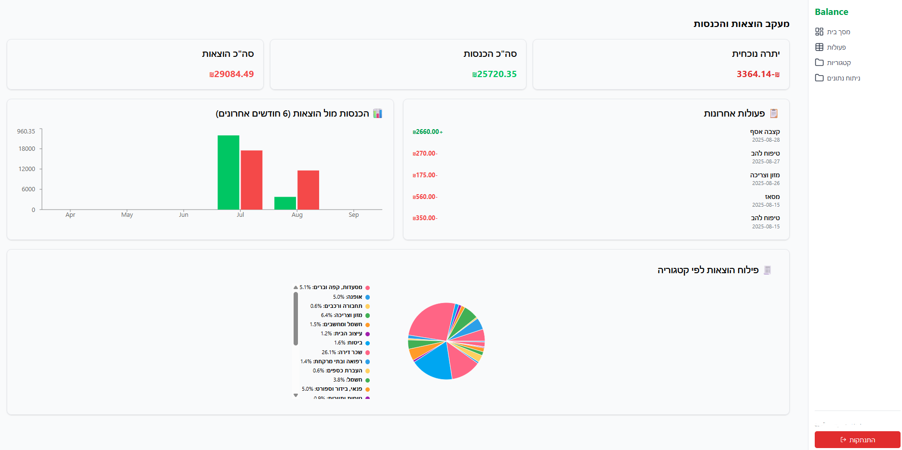
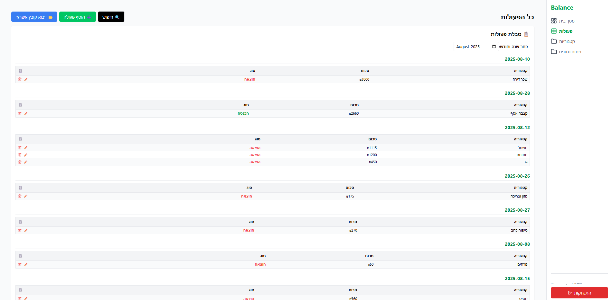

# 💰 Budget Tracker

A personal finance tracker for managing expenses and income with **credit card import**, **visual analytics**, and **smart saving suggestions**.  
Built with **React + Firebase**.

---

## ✨ Features
- 📂 **Credit Card Import (Isracard / Max)** – automatically converts Excel statements into monthly transactions.
- ➕ **Manual Transactions** – add custom expenses or income.
- 📊 **Charts & Reports**:
  - Bar chart: income vs. expenses (last 6 months).
  - Pie chart: expense breakdown by category.
- 💡 **Smart Saving Suggestions (local AI)** – automatic cost-saving recommendations.
- 🔎 **Search & Filter** by date and category.
- 🔐 **User Authentication** via Firebase Auth.

---

## 🖼️ Screenshots

### Dashboard


### Transactions (Actions Page)


### Categories Page


### Analytics Page


---


---

## 🚀 Setup

**Requirements:** Node 18+ and a Firebase project (Auth with Email/Password + Google, and Firestore).

```bash
npm install
npm start          # dev server on http://localhost:3000
npm run build      # production build into ./build
npm test           # test runner (no tests yet)
```

Firebase web config lives in `src/firebase.js`. Replace it with your own project's values and
update `.firebaserc`. Deploy with `firebase deploy --only hosting` after `npm run build`.

> The app queries Firestore directly from the browser, so **Firestore security rules must
> restrict every document to its owner** (`uid == request.auth.uid`). The rules are not yet in this repo.

## 🗂️ Data model (Firestore)

| Collection | Fields |
|---|---|
| `transactions` | `uid`, `date` (`YYYY-MM-DD`), `type` (`הכנסה` / `הוצאה`), `amountAgorot` (positive integer, 1 ILS = 100 agorot, max 1,000,000,000), `amount` (ILS number derived from `amountAgorot`; older documents only have this field), `category`, `merchant`, `source` (`isracard`/`max`), `originalDate`, `chargeDate`, `notes` |
| `categories` | `uid`, `name` |
| `merchantCategories` | `uid`, `merchant`, `merchantNormalized`, `category` (doc id: `<uid>_<merchant>`) |

## 📂 Credit card import

Transactions → "ייבוא קובץ אשראי", choose **Max** or **Isracard**, then upload the `.xlsx` statement
exported from the card's website. Column positions are hard-coded for the current export formats.
Re-importing the same file overwrites the same documents (deterministic IDs). Rows with a zero or out-of-range amount are skipped.
Only `.xlsx` files up to 10 MB are accepted; the extension and the zip signature are checked before anything is parsed.

### Why `xlsx` is installed from cdn.sheetjs.com

The `xlsx` package on the npm registry stopped at 0.18.5, which has known vulnerabilities
(prototype pollution, CVE-2023-30533, fixed in 0.19.3, and a ReDoS, CVE-2024-22363, fixed in 0.20.2).
SheetJS publishes fixed releases only on its own CDN, so `package.json` points at
`https://cdn.sheetjs.com/xlsx-0.20.3/xlsx-0.20.3.tgz` and `package-lock.json` pins its integrity hash.
**Do not switch it back to the npm registry** (`"xlsx": "^0.18.5"`). To upgrade, use a newer
`https://cdn.sheetjs.com/xlsx-<version>/xlsx-<version>.tgz` URL and run `npm test`: `src/lib/xlsxReader.test.js`
pins the sheet rows and parser output for a set of fixture workbooks.

## 🧠 Optional ML service

`src/category_api.py` (Flask) and `src/smart_reclassify.py` are standalone helper scripts, not part of the web app.

## 🧮 Migration: amountAgorot (done)

All `transactions` documents now have the integer `amountAgorot` (1 ILS = 100 agorot). The migration is done and
the temporary legacy fallback in `firestore.rules` has been removed: every create **and every update** of a
transaction must leave a valid `amountAgorot` (integer, 1 to 1,000,000,000). A document without it can still be read
and deleted, but it cannot be updated until it is given a valid `amountAgorot`.

The old `amount` field (ILS number) is still written alongside `amountAgorot` and is derived from it. The app reads
`amountAgorot` and only falls back to `amount` for display of documents that lack it.

The one-off script is kept for reference or for fixing stragglers. It only writes `amountAgorot`, lists documents it
skips (zero, negative, NaN, missing or out-of-range amounts), is idempotent, and is a dry run unless `--apply` is given:

```bash
export GOOGLE_APPLICATION_CREDENTIALS=/path/to/service-account.json
npm run migrate:amount-agorot -- --project <project-id>            # dry run
npm run migrate:amount-agorot -- --project <project-id> --apply    # write
```

Requires Node 22+. See the header of `scripts/migrate-amount-agorot.mjs` for all options.
