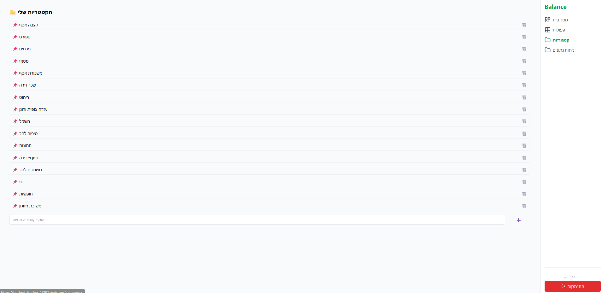
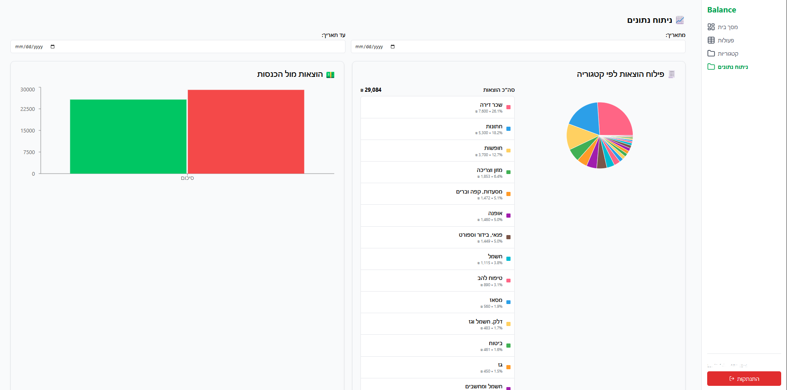

# 💰 Budget Tracker

A personal finance tracker for managing expenses and income with **credit card import**, **visual analytics**, and **smart saving suggestions**.  
Built with **React + Firebase**.

---

## ✨ Features
- 📂 **Credit Card Import (Isracard / Max)** – automatically converts Excel statements into monthly transactions.
- ➕ **Manual Transactions** – add custom expenses or income.
- 📊 **Charts & Reports**:
  - Bar chart: income vs. expenses (last 6 months).
  - Pie chart: expense breakdown by category.
- 💡 **Smart Saving Suggestions (local AI)** – automatic cost-saving recommendations.
- 🔎 **Search & Filter** by date and category.
- 🔐 **User Authentication** via Firebase Auth.

---

## 🖼️ Screenshots

### Dashboard


### Transactions (Actions Page)


### Categories Page


### Analytics Page


---


---

## 🚀 Setup

**Requirements:** Node 18+ and a Firebase project (Auth with Email/Password + Google, and Firestore).

```bash
npm install
npm start          # dev server on http://localhost:3000
npm run build      # production build into ./build
npm test           # test runner (no tests yet)
```

Firebase web config lives in `src/firebase.js`. Replace it with your own project's values and
update `.firebaserc`. Deploy with `firebase deploy --only hosting` after `npm run build`.

> The app queries Firestore directly from the browser, so **Firestore security rules must
> restrict every document to its owner** (`uid == request.auth.uid`). The rules are not yet in this repo.

## 🗂️ Data model (Firestore)

| Collection | Fields |
|---|---|
| `transactions` | `uid`, `date` (`YYYY-MM-DD`), `type` (`הכנסה` / `הוצאה`), `amountAgorot` (positive integer, 1 ILS = 100 agorot, max 1,000,000,000), `amount` (ILS number derived from `amountAgorot`; older documents only have this field), `category`, `merchant`, `source` (`isracard`/`max`), `originalDate`, `chargeDate`, `notes` |
| `categories` | `uid`, `name` |
| `merchantCategories` | `uid`, `merchant`, `merchantNormalized`, `category` (doc id: `<uid>_<merchant>`) |

## 📂 Credit card import

Transactions → "ייבוא קובץ אשראי", choose **Max** or **Isracard**, then upload the `.xlsx` statement
exported from the card's website. Column positions are hard-coded for the current export formats.
Re-importing the same file overwrites the same documents (deterministic IDs). Rows with a zero or out-of-range amount are skipped.

## 🧠 Optional ML service

`src/category_api.py` (Flask) and `src/smart_reclassify.py` are standalone helper scripts, not part of the web app.
